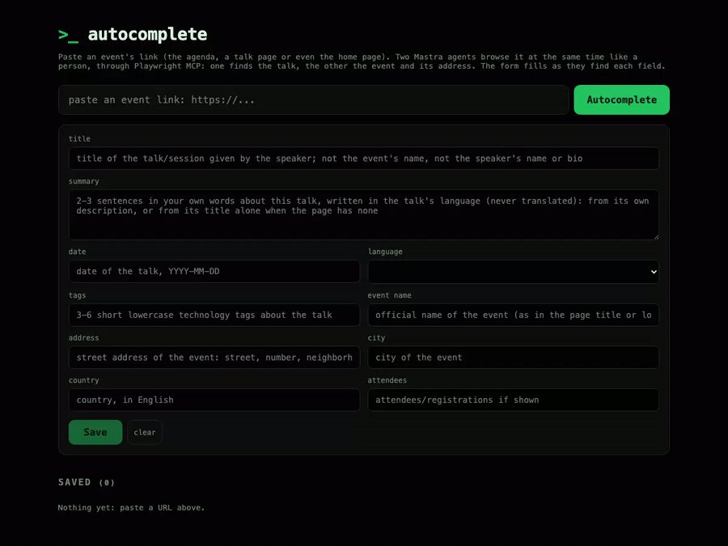
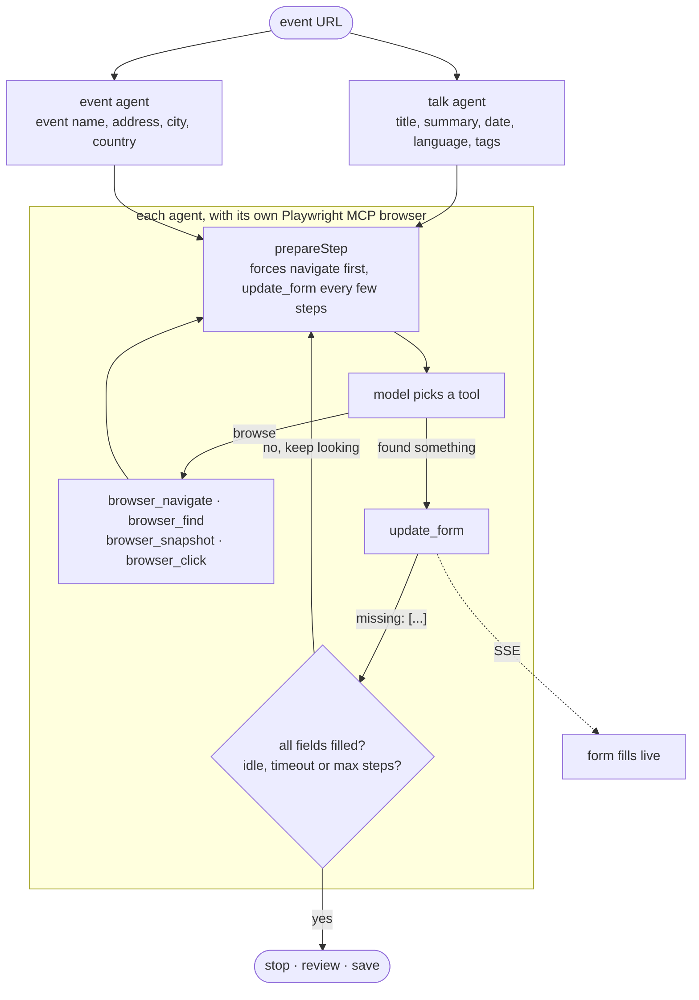

# Mastra + MCP autocomplete

Paste an event's link (the agenda, a talk page or even the home page) and two [Mastra](https://mastra.ai) agents browse
it like a person through the [Playwright MCP server](https://github.com/microsoft/playwright-mcp): one finds the talk,
the other the event and its address. The form fills live as they find each field.



## How it works

Each agent loops on its own browser until its part of the form is complete. Every step is one model call that picks a
tool; `update_form` streams what was found to the page and answers with the fields still `missing`, which steers the
next step.



The code in `src/mastra/` is numbered in reading order (see each file's first comment), from the model and the form
schema to the agent loop in `agent/run-task.ts` and the parallel run in `autocomplete.ts`.

## Run it

You need Node 24 and an OpenRouter API key: [create one here](https://openrouter.ai/settings/keys) (a run costs about
$0.001 with the default model).

```bash
nvm use
npm install
cp .env.example .env   # add your OPEN_ROUTER_KEY
npm start              # http://localhost:3333
```

Other scripts: `npm test`, `npm run typecheck` and `npm run try -- <url>` (runs the agents in the terminal).

The model, the speaker the agents look for, the step budget and the time limits are in `src/config.ts`.

## References

- [Mastra](https://mastra.ai/docs): agents, tools and the MCP client
- [OpenRouter](https://openrouter.ai): one API key for many models
- [Playwright MCP](https://github.com/microsoft/playwright-mcp): the browser the agents drive (`npx @playwright/mcp`)
